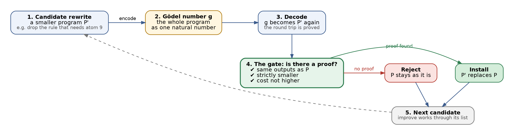
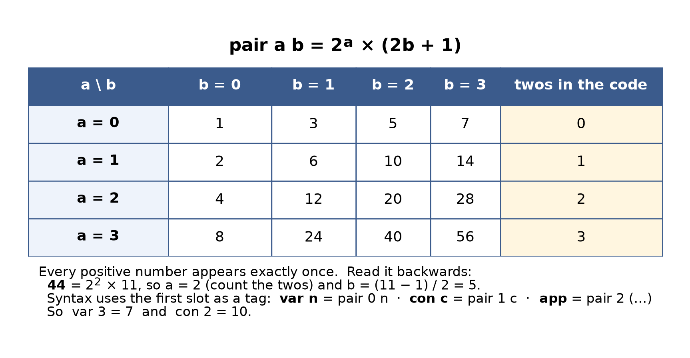
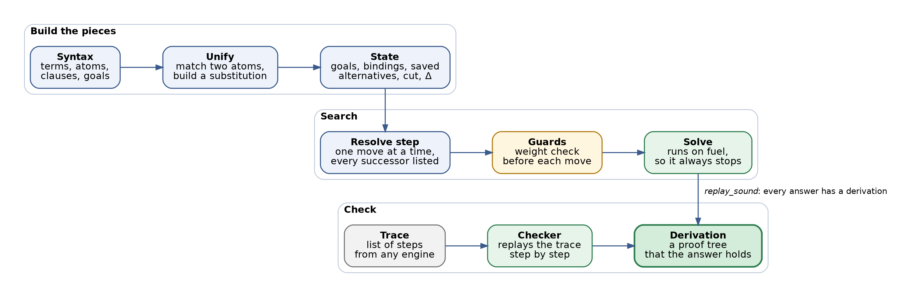
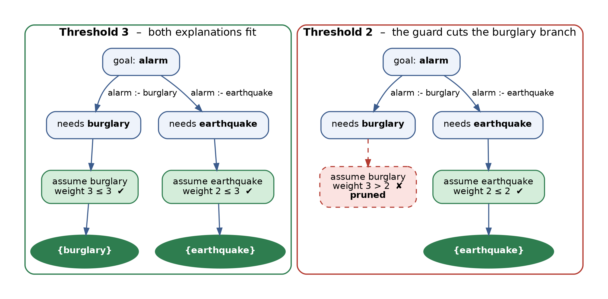

# Gödel Logic

A small logic engine that rewrites itself, and only when it can prove the rewrite is better. This repo holds two Lean 4 projects. `GodelMachine.lean` is the self-rewriting kernel: new code arrives as a single number, and the kernel installs it only if it has a machine-checked proof that the new program gives the same answers, is smaller, and costs no more. `logos-lab/` is a second, separate Lean project that builds a logic engine as a plain step-by-step machine, with unification, cut, a weight guard, a solver that always stops, and a checker that replays a trace and proves it sound.

## The Gödel Machine



The engine runs programs made of rules. A rule says "this fact holds if these facts hold." The set of facts a program can derive is its output. The kernel is built so that this set is always finite and the run always ends.

A rewrite is offered as a **Gödel number**: the whole candidate program squeezed into one natural number. The gate decodes it and then looks for a proof. The proof has to show three things: the outputs did not change, the program got strictly smaller, and the cost did not go up. If the proof exists, the new program is installed. If not, the old one stays. There is no other way in.

The gate comes with a theorem, `install_improves`: anything it installs is an improvement. On top of it sits the loop `improve`, which works through a list of candidates one by one. Its theorem, `improve_never_regresses`, says the loop can never end with a longer program or different outputs than it started with.

The rewrite the kernel knows today is dead-clause elimination. A rule whose body needs a fact that can never be derived does nothing, so it can go. The demo at the bottom of `GodelMachine.lean` does exactly that: a two-rule program has a second rule that waits for a fact that never appears, the smaller program arrives as a number, the gate accepts it, and the outputs stay the same. A new kind of rewrite means a new proof case at the gate, and nothing else.

### How a program becomes a number



The numbering uses one rule: `pair a b = 2^a × (2b + 1)`. The number of twos in the result gives back `a`, and what is left over gives back `b`. Every positive number comes from exactly one pair, so nothing is lost on the way in or out. The table above was computed from the definition in the file.

Terms, goals, rules and whole programs are all coded with this pairing, using the first slot as a tag. Decoding a code gives back exactly what was encoded, and each of those round trips is proved in the file.

## logos-lab



`logos-lab/` asks a different question: what does a logic engine look like when every move is written down as data? It uses a small Prolog-style language of facts and rules with variables and constants.

**Unify** matches two atoms and builds the variable bindings that make them equal. **State** holds everything the search needs at one moment: the goals left, the bindings so far, the saved alternatives for backtracking, the cut barrier, and the hypotheses assumed so far. Backtracking is a list in the state, not hidden control flow. A **Resolve step** takes one state and lists every state that can follow it, in order.

**Cut** throws away the alternatives made since its barrier and keeps the ones before it. `cut_lemma` proves that, and `step_deterministic` proves that the same state always gives the same list of successors.

**Guards** are checks made before every move. The weight guard adds up the cost of the hypotheses assumed so far and stops a branch the moment the total goes over a limit. There is also a guard for the SEND+MORE=MONEY puzzle that rejects a partial digit assignment as soon as a finished column breaks.

**Solve** runs the search on a fuel counter. Every call uses one unit, so it always stops (`solve_terminates`). Each answer is a set of hypotheses plus the bindings. `replay_sound` proves that every answer the solver returns has a full derivation behind it.

The **checker** takes a trace, a list of steps from any engine, and replays it against the program step by step. `checker_sound` proves that if the checker says yes, a derivation exists. The checker does not have to trust whoever made the trace.

### The burglary and alarm example



The program says an alarm goes off if there is a burglary, or if there is an earthquake. We observe the alarm and ask what could explain it. A burglary weighs 3 and an earthquake weighs 2.

With the weight limit at 3, both explanations fit. With the limit at 2, the guard drops the burglary branch before it goes any further, and only the earthquake is left. The build prints this, shown here in short form:

```
threshold 3:  [{abduced=[burglary]}, {abduced=[earthquake]}]
threshold 2:  [{abduced=[earthquake]}]
```

## Run it

You need [elan](https://github.com/leanprover/elan). It reads `lean-toolchain` in each folder and fetches the right Lean version on its own.

The Gödel Machine, Lean 4.10.0, from the top of the repo:

```
lake build
```

logos-lab, Lean 4.12.0:

```
cd logos-lab
lake build
```

The logos-lab build prints the two example results above, along with the axioms each theorem depends on.

## Repo map

```
GodelMachine.lean     the self-rewriting kernel (Lean 4.10.0)
lakefile.lean         build file for the kernel
lean-toolchain        pins Lean 4.10.0
logos-lab/            the logic engine project (Lean 4.12.0)
  LogosLab/           Syntax, Unify, State, Measures, Guards, Finite,
                      Examples, Deriv, Replay
  Root.lean           runs the examples and prints the theorem axioms
  MEASURES.md         the measures and definitions, stated first
  STATUS.md           what is built and what comes next
docs/
  how-it-works.md     a longer walk through both projects
  img/                the figures above (graphviz sources in img/src)
LICENSE               the SnapKitty Opaque Source License v1.0
```

What comes next for logos-lab is in [`logos-lab/STATUS.md`](logos-lab/STATUS.md).

## License

AGPL-3.0-only or the SnapKitty Opaque Source License v1.0, at your choice. The text of the SnapKitty license is in [`LICENSE`](LICENSE), and each source file carries an SPDX header.
